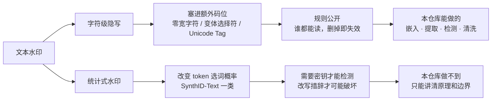

# 数字水印实验室 · digital-watermarking

9 个数字水印 / 隐写 / 溯源工具的纯前端实现。打开网页就能跑，没有构建步骤，没有后端，图片和文本都不出浏览器。

**在线体验 → https://unstone.github.io/digital-watermarking/**

---

## 2026 年水印领域在发生什么

| 动向 | 具体是什么 |
| --- | --- |
| 文字进入水印时代 | Claude 自 2026-08-02 起对文字输出嵌入 SynthID-Text 式统计水印，全局生效、无法关闭 |
| 双层方案成为事实标准 | 不可见水印（藏在像素 / 波形 / token 分布里）+ C2PA 签名清单（藏在文件元数据里），一层被抹掉还有另一层 |
| 覆盖到全模态 | SynthID 已覆盖图像、音频、视频、文本；OpenAI 把音频也纳入了水印与验证工具 |
| 监管是主要推力 | 欧盟 AI Act 第 50 条自 2026-08-02 起对新上线系统生效，要求生成内容带机器可读标记 |
| 检测接口还没开放 | Anthropic 已宣布会提供文字水印检测 API，但截至目前仍不可调用，也没公布定价 |

---

## 蹭个热度：Claude 的文字水印，到底是什么

2026 年 8 月起，Anthropic 给 Claude 的文字输出加上了隐形水印，同时给文件附带 C2PA 内容凭证。
很多人的第一反应是「去搜零宽字符」——**方向错了**。



| | 字符级隐写（本仓库可查） | 统计式水印（Claude / SynthID-Text） |
| --- | --- | --- |
| 藏在哪 | 额外插入的不可见码位 | token 的选词概率分布 |
| 逐字符检查 | 十六进制一看就露 | 完全正常，看不出任何异常 |
| 谁能读 | 任何人，规则公开 | 只有持密钥方 |
| 怎么破坏 | 删掉不可见字符，无损 | 需要改写措辞，短文本本身就不可靠 |
| 典型用途 | 泄密溯源、提示词注入、Trojan Source | 合规标注 AI 生成内容（欧盟 AI Act 第 50 条） |

> 结论：搜零宽字符 / 搜「AI 味」的破折号，**既证明不了、也排除不了** Claude 的水印。

---

## 九个 Demo

| 页面 | 方案 | 载体 | 隐蔽性 | 鲁棒性 | 典型场景 |
| --- | --- | --- | --- | --- | --- |
| [ai-text](pages/ai-text/) | **AI 文本痕迹检测** | 文本 | — | — | 扫不可见字符、还原隐藏载荷、一键清洗 |
| [c2pa](pages/c2pa/) | **C2PA 内容凭证读取** | 文件元数据 | 低（可公开验证） | 低 | 读出 AI 生成声明、编辑动作链、素材来源 |
| [text](pages/text/) | 字符级文本隐写 | 文本 | 高 | 低 | 定向分发溯源，查谁泄的稿 |
| [according](pages/according/) | 明水印 + 全屏无痕水印 | 图片 / 截图 | 无 / 高 | 中 / 低 | 版权声明；后台页面防截图外传 |
| [exif](pages/exif/) | EXIF 元信息 | 图片文件 | 低 | 极低 | 取证；也是最容易泄露隐私的地方 |
| [lsb-order](pages/lsb-order/) | LSB · 顺序编码 | 无损图片 | 高 | 低 | 原图分发溯源 |
| [lsb-img](pages/lsb-img/) | LSB · 图形通道 | 无损图片 | 高 | 低 | 水印直接「显影」，不需要解码格式 |
| [lsb-encryption](pages/lsb-encryption/) | LSB · 口令加密 | 无损图片 | 高 | 低 | 带 AES 的隐写，第三方实现对照 |
| [fft](pages/fft/) | 频域盲水印 | 图片 | 高 | **高** | 要扛住转发、压缩、截屏的场景 |

> ⚠️ LSB 类水印只在无损格式下成立。导出必须用 PNG，一旦被存成 JPEG 或平台二次压缩，最低有效位会被直接抹掉。

---

## 检测器能识别什么

| 类别 | 码位范围 | 风险 | 常见用途 |
| --- | --- | --- | --- |
| 零宽字符 | `U+200B` `U+200C` `U+200D` `U+2060` `U+FEFF` | 高 | 最常见的文本隐写载体 |
| 变体选择符 | `U+FE00–FE0F` `U+E0100–E01EF` | 高 | 每个字符后可挂一整个字节 |
| Unicode Tag | `U+E0000–E007F` | 高 | 对 LLM 的隐形提示词注入 |
| 双向控制符 | `U+202A–202E` `U+2066–2069` | 高 | Trojan Source，显示顺序 ≠ 真实顺序 |
| 异常空格 | `U+00A0` `U+202F` `U+2000–200A` 等 | 中 | 破坏分词、匹配和 diff |
| 同形异义字 | 拉丁 / 西里尔 / 希腊混排 | 中 | 钓鱼域名、冒充账号 |
| 排版线索 | `—` `…` `“”` | — | **不是水印**，只是文风的弱信号 |

---

## 三种字符级编码方案

| 方案 | 每字节占用 | 载荷范围 | 说明 |
| --- | --- | --- | --- |
| 零宽字符 | 4 个字符（2 bit/字符，四进制） | 任意 UTF-8 | 兼容性最好 |
| 变体选择符 | 1 个字符 | 任意 UTF-8 | 最紧凑；`VS1–16` 映射 `0x00–0F`，`VS17–256` 映射 `0x10–FF` |
| Unicode Tag | 1 个字符 | 仅可见 ASCII | `ASCII + 0xE0000` |

载荷统一先转 UTF-8 再编码，所以中文和 emoji 都能塞。

---

## 目录结构

```
├── index.html              首页
├── 404.html                GitHub Pages 404
├── robots.txt / sitemap.xml
├── .nojekyll               按静态文件原样发布，不走 Jekyll
├── google*.html            Google Search Console 验证文件，勿删（删了验证会失效）
├── assets/
│   ├── theme.css           全站设计系统（深浅色自动跟随系统）
│   ├── ui.js               toast / 复制 / PNG 导出 / 顶部导航
│   ├── invisible.js        不可见字符引擎：3 种编解码 + 扫描器
│   ├── c2pa.js             C2PA 读取器：JUMBF 盒子树 + CBOR 解码
│   ├── og.png              社交分享卡片
│   └── favicon.svg
└── pages/
    ├── utils.js            图片类 Demo 共用工具
    ├── ai-text/            AI 文本痕迹检测
    ├── c2pa/               C2PA 内容凭证读取器
    ├── text/               文本隐形水印
    ├── according/          明水印 + 全屏无痕水印
    ├── exif/               EXIF 元信息
    ├── lsb-order/          LSB · 顺序编码
    ├── lsb-img/            LSB · 图形通道
    ├── lsb-encryption/     LSB · 口令加密（第三方实现）
    └── fft/                频域盲水印
```

## 本地运行

纯静态，任意 HTTP 服务器即可（`file://` 打不开，浏览器会拦跨目录脚本）：

```bash
python3 -m http.server 8765
```

然后访问 http://localhost:8765 。

## C2PA 读取器实现要点

无第三方依赖，`assets/c2pa.js` 自己实现了整条链路：

| 环节 | 做法 |
| --- | --- |
| 容器提取 | JPEG 扫 APP11（`0xFFEB`）分片按 `z` 序号重组；PNG 找 `caBX` 块；WebP 找 `C2PA` RIFF 块；都找不到则按 `jumb`+`jumd` 特征串兜底扫描 |
| 盒子树 | 递归解析 JUMBF（ISO/IEC 19566-5）：4 字节长度 + 4 字节类型，`jumd` 描述盒里取 UUID 与 label |
| 声明解码 | 内置极简 CBOR 解码器（RFC 8949 子集），解 claim、assertions、ingredient |
| AI 判定 | 看 `c2pa.actions` 与 IPTC 断言里的 `digitalSourceType` 是否为 `trainedAlgorithmicMedia` 一类 |
| 不做的事 | 不校验 COSE 签名与证书链，只显示签名是否存在 |

---

## 参考与致谢

- `pages/lsb-encryption/` 直接沿用了 [PixelJihad](https://github.com/oakes/PixelJihad)（作者 Zach Oakes），仅作对照演示
- `pages/exif/` 使用 [ExifReader](https://github.com/mattiasw/ExifReader)
- `pages/fft/` 依赖 opencv.js（约 11 MB，首次使用时才按需加载）
- SynthID-Text 原理见 Google DeepMind 发表于 Nature（2024）的论文
- C2PA 规范见 [spec.c2pa.org](https://spec.c2pa.org/)，示例文件取自 [contentauth/c2pa-rs](https://github.com/contentauth/c2pa-rs) 的测试用例
